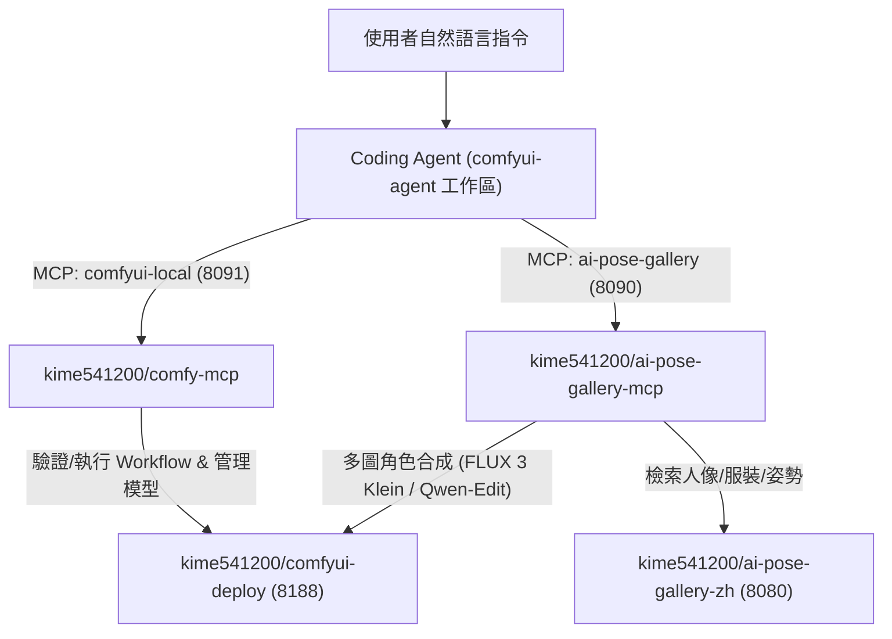

# comfyui-agent：AI Agent 生圖工作區（Studio Workspace）

開箱即用的地端 AI 繪圖 Agent 工作區。使用者只需在本目錄啟動 Coding Agent（如 Claude Code、Cursor、Antigravity）session，Agent 即可根據自然語言需求自動查詢模型、套用工作流模板、從 4,345 張圖庫挑選姿勢／服裝／人像參考圖，並驅動本地 ComfyUI 生成圖片。

---

## 1. 架構與搭配服務

本工作區透過 **Streamable HTTP MCP** 串接以下容器服務（不需在本目錄安裝 Python `.venv`）：

| 服務角色 | 對應開源 Repo | 預設端點 | 說明 |
| --- | --- | --- | --- |
| **ComfyUI 引擎（必備）** | [kime541200/comfyui-deploy](https://github.com/kime541200/comfyui-deploy) | `http://127.0.0.1:8188` | 以 `PROFILE=pose-gallery` 啟動預裝 `DepthAnythingV2` 與 `GGUF` 的 GPU 容器 |
| **`comfyui-local` MCP（必備）** | [kime541200/comfy-mcp](https://github.com/kime541200/comfy-mcp) | `http://127.0.0.1:8091/mcp` | 負責節點與模型探索、API Workflow 驗證與執行、Hugging Face 模型下載 |
| **`ai-pose-gallery` MCP（選配）** | [kime541200/ai-pose-gallery-mcp](https://github.com/kime541200/ai-pose-gallery-mcp) | `http://127.0.0.1:8090/mcp` | 搭配 [kime541200/ai-pose-gallery-zh](https://github.com/kime541200/ai-pose-gallery-zh) 提供姿勢／服裝／人像模糊檢索與多圖角色合成 |
| **LoRA 訓練環境（選配）** | [kime541200/lora-training](https://github.com/kime541200/lora-training) | *(離線訓練容器)* | 訓練產出的角色 `.safetensors` 可放入 ComfyUI `models/loras` 由本工作區驗證生圖 |

---

## 2. 內建工作流模板庫（`workflows/`）

所有模板皆為可直接提交至 ComfyUI `/prompt` 或 `comfyui-local` `run_workflow_json` 的 API 格式 JSON：

- [`workflows/flux3-klein-edit.api.json`](workflows/flux3-klein-edit.api.json)（**多圖合成預設推薦**）：
  **FLUX 3 Image Klein Distilled (Int8)** 多圖參考（人像／雙角色＋服裝＋姿勢 `DepthAnythingV2` 3D 深度輪廓）合成工作流，16 GB VRAM 常駐不需 CPU Offload，約 35–45 秒／張。
- [`workflows/qwen-image-edit-2509.api.json`](workflows/qwen-image-edit-2509.api.json)（**多圖合成備選**）：
  **Qwen-Image-Edit-2509 (GGUF Q4_K_M)** + 4 步 Lightning LoRA 三圖參考（含 `DepthAnythingV2` 3D 深度姿勢控制）合成工作流。
- [`workflows/sdxl-txt2img.api.json`](workflows/sdxl-txt2img.api.json)：
  SDXL / Illustrious 1024 級標準文生圖工作流。
- [`workflows/sdxl-lora.api.json`](workflows/sdxl-lora.api.json)：
  SDXL / Illustrious 載入 LoRA 驗證與生圖工作流（可搭配 [kime541200/lora-training](https://github.com/kime541200/lora-training) 產出的模型）。

---

## 3. 快速上手

1. 依 [`docs/setup.md`](docs/setup.md) 啟動 ComfyUI 與 MCP 容器，並參考 [`mcp_config.example.json`](mcp_config.example.json) 將 `comfyui-local` 與 `ai-pose-gallery` 註冊至你的 Coding Agent。
2. 在本目錄啟動 Agent session，直接用中文下達指令，例如：
   - *「幫我從圖庫找一個短髮女生、穿夏季連身裙、回頭看的姿勢，確認後用 FLUX 3 合成全身照」*
   - *「幫我檢查 ComfyUI 目前有哪些 SDXL checkpoint 與 LoRA，並用 `sdxl-lora.api.json` 測試剛訓練好的角色 LoRA」*
3. Agent 操作規範與錯誤排解請見 [`AGENTS.md`](AGENTS.md)。歡迎提交 Issue 或 PR 擴充更多工作流模板！
